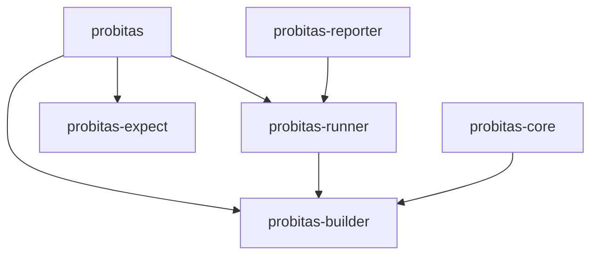
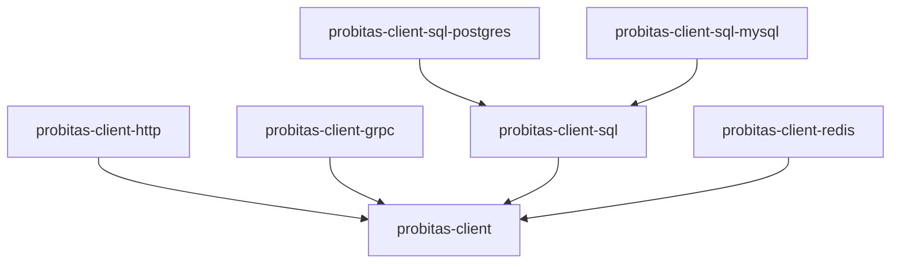

# Package Structure

Workspace organization and dependency management for Probitas monorepo.

## Directory Layout

```
probitas-packages/
├── package.json                  # Bun workspace root (scripts, dev tools)
├── internal/testing/             # Private test helpers (bun:test adapter)
├── packages/
│   ├── probitas-builder/         # @probitas-test/builder - Type-safe scenario definition
│   ├── probitas-runner/          # @probitas-test/runner - Scenario execution engine
│   ├── probitas-reporter/        # @probitas-test/reporter - Output formatters
│   ├── probitas-core/            # @probitas-test/core - Scenario loading/filtering
│   ├── probitas-discover/        # @probitas-test/discover - File discovery
│   ├── probitas-expect/          # @probitas-test/expect - Expectation library
│   ├── probitas-client/          # @probitas-test/client - Core client library
│   ├── probitas-client-http/     # @probitas-test/client-http - HTTP client
│   ├── probitas-client-grpc/     # @probitas-test/client-grpc - gRPC client
│   ├── probitas-client-sql/      # @probitas-test/client-sql - SQL client base
│   ├── probitas-client-sql-postgres/
│   ├── probitas-client-sql-mysql/
│   └── ... (redis, mongodb, rabbitmq, sqs, etc.)
```

Note: `@probitas-test/probitas` (the user-facing entry point and CLI) is
maintained in the
[probitas repository](https://github.com/probitas-test/probitas).

## Package Hierarchy

### Framework Packages



### Client Packages



## Dependency Management

- **Each package declares its own dependencies** in its `package.json`. Bun
  installs workspaces in isolated mode, so an undeclared import does not resolve
  even if a sibling depends on it.
- **Inter-package dependencies** use `"@probitas-test/<name>": "workspace:*"`.
- **npm names use the `@probitas-test` scope** (`@probitas` is taken on npm);
  JSR names stay `@probitas/*`. Import specifiers in source use the npm names.
- **JSR-only dependencies** (`@std/*`, `@core/*`) come from the `@jsr` npm
  mirror configured in `bunfig.toml`, e.g.
  `"@std/assert": "npm:@jsr/std__assert@^1"`.
- **Shared dev tools** (TypeScript, Biome, dprint) live in the root
  `package.json`.
